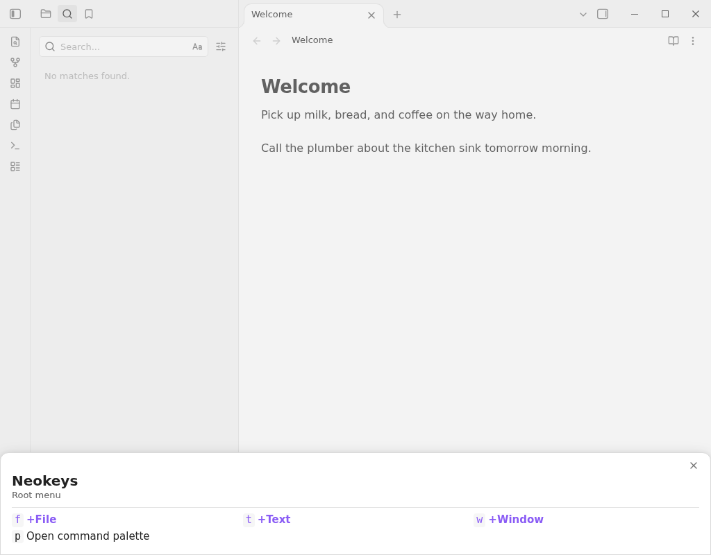
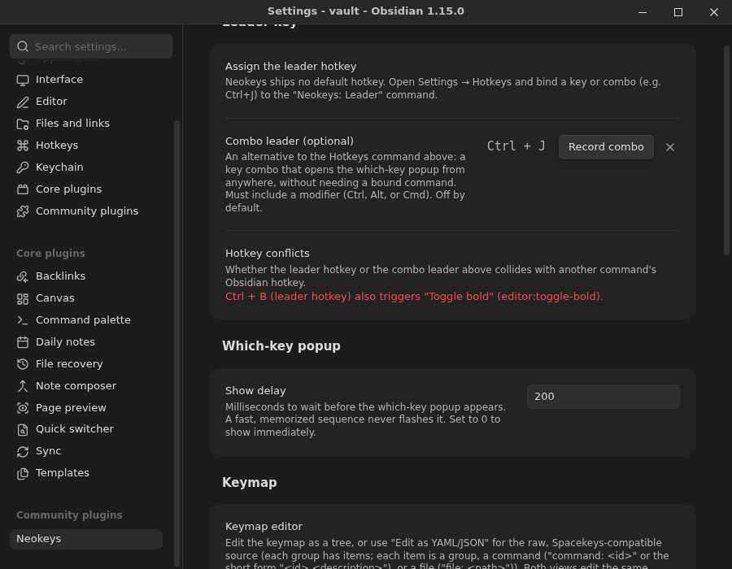
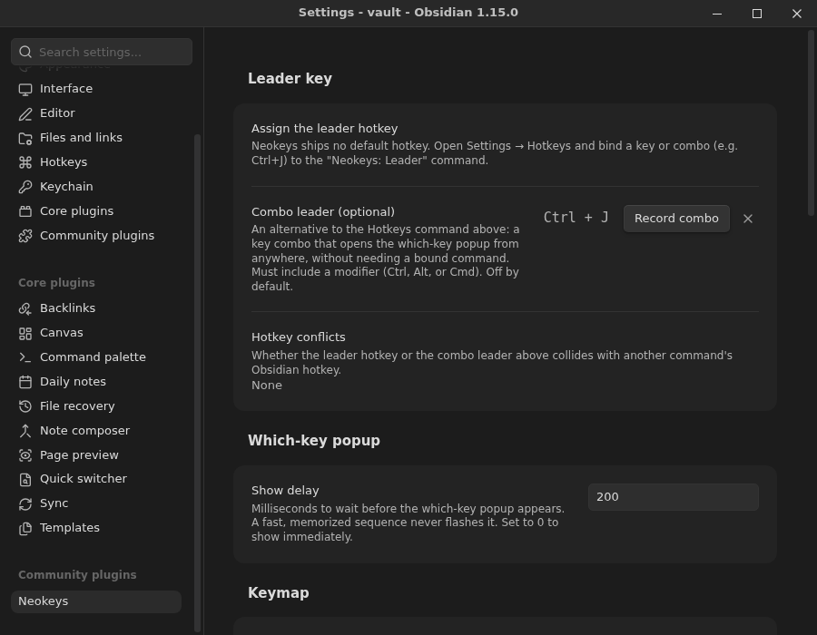
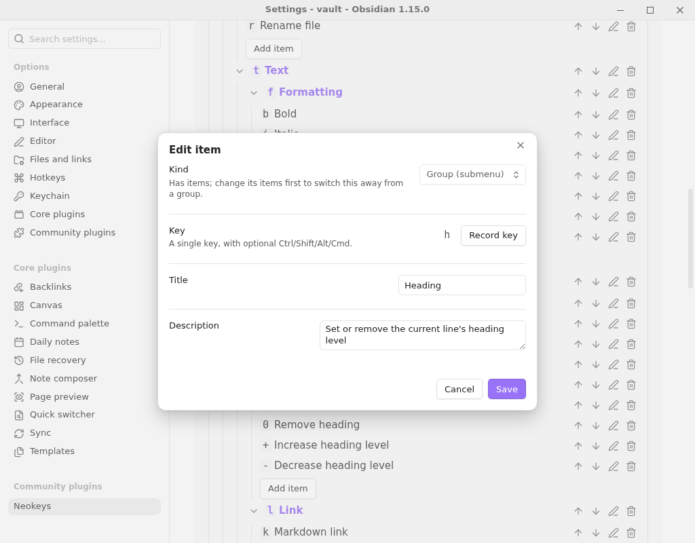
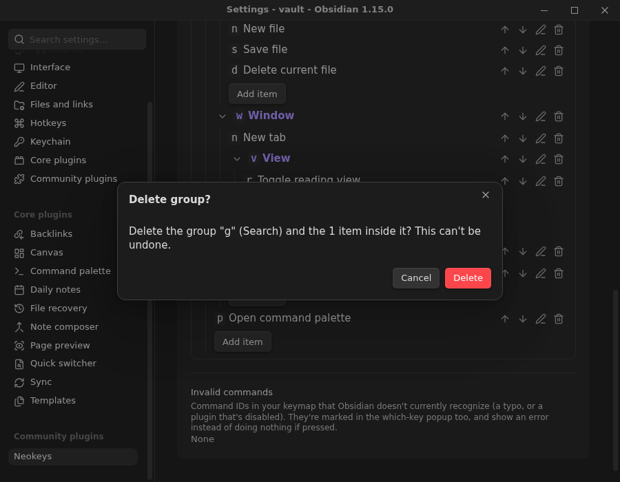

# Neokeys

Neovim-inspired leader keys and sequential keybindings for Obsidian, loosely based on
[Spacekeys](https://github.com/jlumpe/obsidian-spacekeys). Press a leader key, then a short
sequence of keys, to walk a branching, which-key-style menu of commands and files instead of
hunting for a hotkey.



## Installation

### From Obsidian's Community plugins

1. Open Settings → Community plugins → Browse.
2. Search for **Neokeys** and select **Install**, then **Enable**.

### From a release (manual)

1. Download `main.js`, `manifest.json`, and `styles.css` from the
   [latest release](https://github.com/friesentius/obsidian-neokeys/releases/latest) into
   `<your-vault>/.obsidian/plugins/neokeys/`.
2. Reload Obsidian (or disable/re-enable the plugin) and turn on **Neokeys** under
   Settings → Community plugins.

### From source

1. Clone or download this repository into `<your-vault>/.obsidian/plugins/neokeys/`.
2. Build the plugin: `npm install && npm run build`.
3. Reload Obsidian (or disable/re-enable the plugin) and turn on **Neokeys** under
   Settings → Community plugins.

## Setting up the leader key

Neokeys ships with **no default hotkey** (this is deliberate, and is what Obsidian's plugin
guidelines expect). To assign one:

1. Open Settings → Hotkeys.
2. Search for **Neokeys: Leader**.
3. Click the `+` and press the key or combo you want as your leader (e.g. `Ctrl+J`; avoid combos
   Obsidian already uses, like `Ctrl+B` for Bold).

Pressing the leader opens the which-key popup at the root of your keymap. Type further keys to
descend into a group, <kbd>Backspace</kbd> to go back up one level, and <kbd>Esc</kbd> to close
the popup at any point. The header shows a breadcrumb of the group labels you've descended
through (e.g. `Text > Heading`), not just the raw keys you pressed.

### Combo leader (optional)

As an alternative to the Hotkeys command above, Settings → Neokeys has a **Combo leader** field:
click **Record combo** and press the key combo you want, e.g. `Ctrl+J`. This opens the which-key
popup directly, without needing a bound Obsidian command. It's off (empty) by default, so
existing users see no change, and it must include a modifier (Ctrl, Alt, or Cmd) - a bare or
shift-only combo is rejected with an explanation, since a modifier-free leader would collide with
ordinary typing. Click the `x` button next to the field to clear it.

### Hotkey conflicts

Settings → Neokeys has a **Hotkey conflicts** row that checks both the leader hotkey (from
Settings → Hotkeys) and the combo leader above against every other command's current Obsidian
hotkey, and names the colliding command if either one collides (e.g. binding the leader to
`Ctrl+B` shows that it also triggers Obsidian's own "Toggle bold"). This is a warning only -
Neokeys doesn't block the binding - since Obsidian itself lets the same key trigger more than one
thing and you may prefer Neokeys to win.



## Animations

Settings → Neokeys has an **Animations** toggle (on by default) and an **Animation duration**
field (0-1000ms, default 150). With animations on, the which-key popup slides in from the bottom
edge when it first appears, and crossfades between menus as you navigate into or back out of a
group. Keypress handling is never affected by this - a fast sequence of keys is read and acted on
immediately regardless of what's currently animating. If your OS has a reduced-motion
accessibility preference turned on, Neokeys never animates, no matter how the toggle is set.

## The keymap

Open Settings → Neokeys to edit the keymap as an expandable **tree**: add, edit, delete, and
reorder groups, commands, and files; edit a group's title and description (along with any entry's
key) through the same **Edit** dialog used for commands and files, since the root menu is the only
place those fields are shown inline; and pick a command from Obsidian's currently registered
commands with a searchable picker, rather than typing a raw command ID by hand. Click
**Edit as YAML/JSON** to switch to the raw, Spacekeys-compatible
source instead (JSON is also accepted, since JSON is valid YAML) - both views edit the same stored
keymap, so a change in one shows up in the other, and switching back from the YAML view with
invalid text is blocked (with the error shown) rather than silently discarding your edit or
overwriting the tree.





The which-key popup shows a group's entries in the order you arrange them in the tree editor (or
write them in the YAML's `items`) - reordering an item moves it in the popup too, not just in the
editor. Within that stored order, groups are always listed before files, and files before
commands, so submenus stay easy to find first.

The schema is Spacekeys-compatible, with a `title` added to each group so the which-key popup can
show a heading for the section you're in. Every entry under `items` is one of:

- **A group** - has nested `items`, plus an optional `title` and `description` shown as the
  popup's header when you're inside it.
- **A command** - `command: <command-id>`, or the short form `"<command-id> <description>"`.
  An optional `description` overrides the label shown in the popup.
- **A file** - `file: <vault-relative-path>`, opened with the same resolution as Obsidian's
  internal links. An optional `description` overrides the label.

```yaml
title: Neokeys
description: Root menu
items:
  f:
    title: File
    description: Create, open, and manage files
    items:
      n: file-explorer:new-file New file
      s: editor:save-file Save file
      d: app:delete-file Delete current file
  t:
    title: Text
    description: Formatting for the current selection or line
    items:
      h:
        title: Heading
        description: Set or remove the current line's heading level
        items:
          '1': editor:set-heading-1 Heading 1
          '+': neokeys:increase-heading-level Increase heading level
          '-': neokeys:decrease-heading-level Decrease heading level
```

### The default keymap

A fresh install ships with four root groups: **File** (`f`), **Text** (`t`), **Window** (`w`),
and **Command palette** (`p`). Text groups formatting under five subgroups - **Formatting** (`f`:
bold, italic, strikethrough, code, highlight, blockquote, clear formatting), **Heading** (`h`:
set heading 1-6, remove heading, and increase/decrease heading level), **Link**
(`l`: Markdown link, wikilink, embed), **List** (`-`: bullet/numbered list, checklist, indent), and
**Add** (`a`: table, code block, math, footnote, horizontal rule, callout, tag). Window groups
tab/split/window management, loosely following the terminal multiplexer herdr's tab/pane/workspace
mnemonics (`c` for new, not `n`, so `n`/`p` stay free for next/previous); splitting is bound
directly on `v` (split right) and `-` (split down), not through a submenu.

#### Increase/decrease heading level

Obsidian has no built-in command to shift a heading's level up or down - only jump to an absolute
level (`editor:set-heading-1`..`-6`) or remove it (`editor:set-heading-0`). Neokeys adds its own
`neokeys:increase-heading-level` and `neokeys:decrease-heading-level` commands (bound to `h +` /
`h -` in the Heading submenu) that read the current line's heading level and step it by one.
"Increase" cycles plain text -> H1 -> H2 -> ... -> H6 -> plain text; "decrease" is the exact
reverse, plain text -> H6 -> H5 -> ... -> H1 -> plain text. Both ends wrap rather than stopping, so
either command can be pressed repeatedly to cycle through every level. Both commands apply to
every line touched by the current selection, or the cursor's line when nothing is selected; a
multi-line selection that ends at the very start of a line leaves that last line alone.

A key string is an optional run of modifier letters (`c`/`s`/`a`/`m` for ctrl/shift/alt/meta)
followed by a `-` and a base key, e.g. `c-enter` for Ctrl+Enter, or just a single character for
an unmodified key, e.g. `f`. Printable characters are case-sensitive: `F` is Shift+F, and `s-f`
or `cs-f` are equivalent to `F` and `c-F`. Any other shifted character must be written as the
character itself, e.g. `?` rather than `s-/` or `!` rather than `s-1`; those forms are rejected.
A handful of named keys are recognized as aliases: `space`, `up`/`down`/`left`/`right`, `enter`,
`esc`, `tab`, `backspace`, `delete`, `home`, `end`, `pageup`, `pagedown`, `insert`, and
`f1`–`f12`.

Tree edits save immediately. In the YAML/JSON view, click **Save keymap** to apply changes; an
invalid keymap is rejected with an error message that points at the exact field (e.g.
`items.f.items.d`) that needs fixing, and the previously saved keymap keeps working until you fix
it.

Any edit made in the tree editor rewrites the stored keymap in a normalized YAML form: comments are
dropped and the short command form (`"<command-id> <description>"`) is expanded into explicit
`command`/`description` fields. Editing only through the YAML/JSON view never rewrites anything, so
your comments and formatting are kept exactly as you wrote them there. Deleting a group that still
has items asks for confirmation first, naming the group and how many entries it contains; deleting
anything else happens in one click.



A keymap can still *parse* successfully but reference a command ID Obsidian doesn't currently
recognize (a typo, or a plugin that's disabled) - this doesn't block saving, since the command
might belong to a plugin you just haven't enabled yet. Settings → Neokeys lists any such entries
under **Invalid commands**, by key path and command ID, and the which-key popup marks the same
entries in red with an "Unknown command" badge; pressing one shows a notice instead of silently
doing nothing.

The **show delay** setting controls how long (in milliseconds) the popup waits before revealing
the key/label grid (with animations on, the whole bar waits, then slides in as its backdrop fades
in), so a sequence you already know by muscle memory never flashes it. There is no forced
abandon-timeout: a half-typed sequence waits indefinitely until it resolves, dead-ends, is
backspaced away, or you press Esc.

## Compatibility

Desktop only for now (`isDesktopOnly: true`); mobile support is a possible future stretch goal,
since there is no public API signal for "a hardware keyboard is attached."

## Development

- `npm install`
- `npm run dev` - esbuild in watch mode
- `npm run build` - typecheck + production build
- `npm test` - Jest unit tests (key parsing, keymap parsing/validation and serialization, tree
  edit operations, tree resolution/sorting, delay logic, combo-leader validation, command-ID
  validation, breadcrumb building, hotkey-conflict detection, animation settings, heading-level
  increase/decrease)
- `npm run lint` - ESLint with `eslint-plugin-obsidianmd`'s recommended config, plus
  `@eslint/css`'s `no-important` on `styles.css`, mirroring the community directory's source and
  CSS scans (see `eslint.config.mjs` for why the plugin version is pinned)
- `npm run validate` - mirrors the parts of Obsidian's community-plugin submission checks that
  don't require a live GitHub release (manifest/versions shape, `id`/`version` format)

### Branching and releases

Feature and fix PRs target `dev`, not `main` (`.no-mistakes.yaml` sets this as the default PR
base branch); CI runs on pushes and PRs to both. `main` stays the GitHub default branch, since
Obsidian reads the default branch's manifest for the community-plugin listing.

To cut a release: bump the version with `npm version <patch|minor|major> --no-git-tag-version`
(updates `package.json`, `manifest.json`, and `versions.json` without creating a git tag),
then open a `dev` -> `main` PR whose description is the release notes. Merging that PR into
`main` publishes the release with no manual tagging: `.github/workflows/release.yml` reads
`manifest.json`'s version on every push to `main` and, only when no release for that exact
version exists yet, runs lint/typecheck/test/build/validate, then creates the annotated tag,
then publishes the GitHub release with the PR body as notes, followed by the generated commit
list. Merging a PR without a version bump (or re-merging the same version) is a no-op release
run.

## Support

If Neokeys is useful to you, you can support its development on
[Ko-fi](https://ko-fi.com/friesentius).

## License

[MIT](LICENSE)
