# Neokeys

Neovim-inspired leader keys and sequential keybindings for Obsidian, loosely based on
[Spacekeys](https://github.com/jlumpe/obsidian-spacekeys). Press a leader key, then a short
sequence of keys, to walk a branching, which-key-style menu of commands and files instead of
hunting for a hotkey.

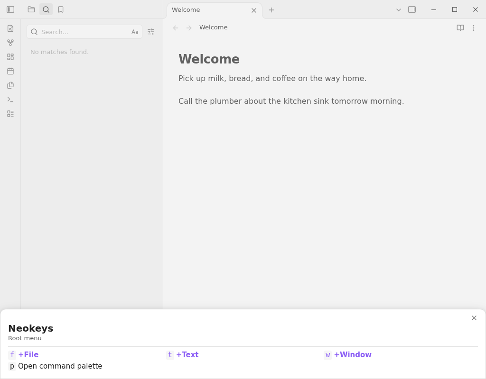

## Installation

### From Obsidian's Community plugins

1. Open Settings → Community plugins → Browse.
2. Search for **Neokeys** and select **Install**, then **Enable**.

### From a release (manual)

1. Download `main.js`, `manifest.json`, and `styles.css` from the
   [latest release](https://github.com/friesentius/obsidian-neokeys/releases/latest) into
   `<your-vault>/.obsidian/plugins/neokeys/`.
2. Reload Obsidian (or disable/re-enable the plugin) and turn on **Neokeys** under
   Settings → Community plugins.

### From source

1. Clone or download this repository into `<your-vault>/.obsidian/plugins/neokeys/`.
2. Build the plugin: `npm install && npm run build`.
3. Reload Obsidian (or disable/re-enable the plugin) and turn on **Neokeys** under
   Settings → Community plugins.

## Setting up the leader key

Neokeys ships with **no default hotkey** (this is deliberate, and is what Obsidian's plugin
guidelines expect). To assign one:

1. Open Settings → Hotkeys.
2. Search for **Neokeys: Leader**.
3. Click the `+` and press the key or combo you want as your leader (e.g. `Ctrl+J`; avoid combos
   Obsidian already uses, like `Ctrl+B` for Bold).

Pressing the leader opens the which-key popup at the root of your keymap. Type further keys to
descend into a group, <kbd>Backspace</kbd> to go back up one level, and <kbd>Esc</kbd> to close
the popup at any point. The header shows a breadcrumb of the group labels you've descended
through (e.g. `Text > Heading`), not just the raw keys you pressed.

### Combo leader (optional)

As an alternative to the Hotkeys command above, Settings → Neokeys has a **Combo leader** field:
click **Record combo** and press the key combo you want, e.g. `Ctrl+J`. This opens the which-key
popup directly, without needing a bound Obsidian command. It's off (empty) by default, so
existing users see no change, and it must include a modifier (Ctrl, Alt, or Cmd) - a bare or
shift-only combo is rejected with an explanation, since a modifier-free leader would collide with
ordinary typing. Click the `x` button next to the field to clear it.

### Hotkey conflicts

Settings → Neokeys has a **Hotkey conflicts** row that checks both the leader hotkey (from
Settings → Hotkeys) and the combo leader above against every other command's current Obsidian
hotkey, and names the colliding command if either one collides (e.g. binding the leader to
`Ctrl+B` shows that it also triggers Obsidian's own "Toggle bold"). This is a warning only -
Neokeys doesn't block the binding - since Obsidian itself lets the same key trigger more than one
thing and you may prefer Neokeys to win.

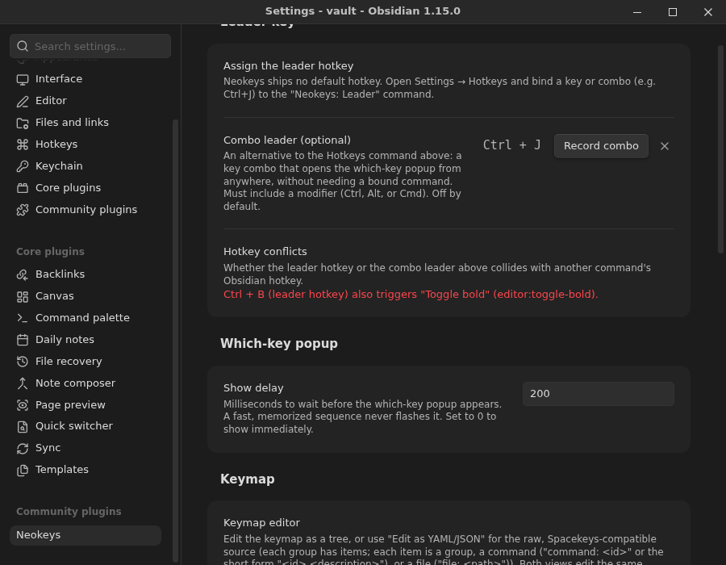

## Animations

Settings → Neokeys has an **Animations** toggle (on by default) and an **Animation duration**
field (0-1000ms, default 150). With animations on, the which-key popup slides in from the bottom
edge when it first appears, and crossfades between menus as you navigate into or back out of a
group. Keypress handling is never affected by this - a fast sequence of keys is read and acted on
immediately regardless of what's currently animating. If your OS has a reduced-motion
accessibility preference turned on, Neokeys never animates, no matter how the toggle is set.

## The keymap

Open Settings → Neokeys to edit the keymap as an expandable **tree**: add, edit, delete, and
reorder groups, commands, and files; edit a group's title and description (along with any entry's
key) through the same **Edit** dialog used for commands and files, since the root menu is the only
place those fields are shown inline; and pick a command from Obsidian's currently registered
commands with a searchable picker, rather than typing a raw command ID by hand. Click
**Edit as YAML/JSON** to switch to the raw, Spacekeys-compatible
source instead (JSON is also accepted, since JSON is valid YAML) - both views edit the same stored
keymap, so a change in one shows up in the other, and switching back from the YAML view with
invalid text is blocked (with the error shown) rather than silently discarding your edit or
overwriting the tree.

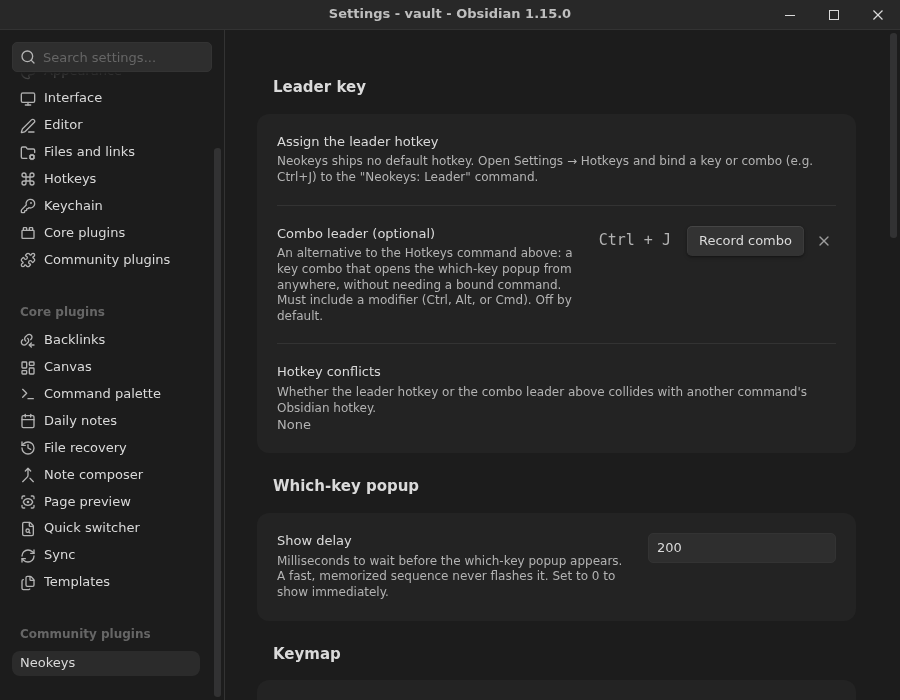

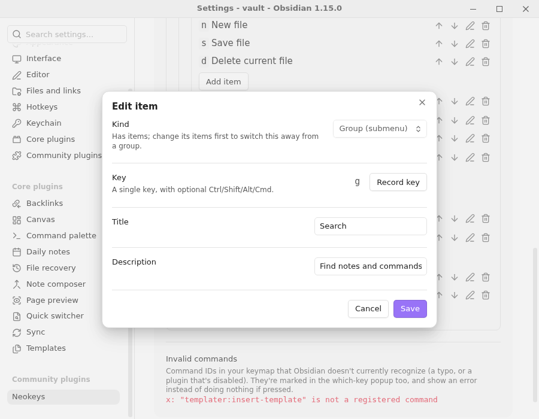

The which-key popup shows a group's entries in the order you arrange them in the tree editor (or
write them in the YAML's `items`) - reordering an item moves it in the popup too, not just in the
editor. Within that stored order, groups are always listed before files, and files before
commands, so submenus stay easy to find first.

The schema is Spacekeys-compatible, with a `title` added to each group so the which-key popup can
show a heading for the section you're in. Every entry under `items` is one of:

- **A group** - has nested `items`, plus an optional `title` and `description` shown as the
  popup's header when you're inside it.
- **A command** - `command: <command-id>`, or the short form `"<command-id> <description>"`.
  An optional `description` overrides the label shown in the popup.
- **A file** - `file: <vault-relative-path>`, opened with the same resolution as Obsidian's
  internal links. An optional `description` overrides the label.

Any of the three can also carry an optional `icon`: the id of one of Obsidian's icons
(e.g. `icon: folder` or `icon: lucide-file-plus`). The mobile dial draws it on the item's circle in
place of the key, and the tree editor shows it beside the entry; the key still shows in the pill
and in the which-key popup, and an item with no `icon` is unchanged. The **Edit** dialog has an
**Icon** field with a searchable picker of every icon Obsidian ships, and a clear button. An icon
id Obsidian does not know is kept as written (a plugin's icon may simply not be loaded) and the
circle falls back to the key. Keymaps written before `icon` existed load unchanged.

#### Items with no key

A phone has no hotkeys, and on the dial the key only labels a circle, so on a phone an item needs
**a key or an icon** (either one is enough). On a phone a key only labels the circle (when the item
has no icon) and works with an attached keyboard; it is mainly kept so the same item has its leader
key on your desktop and tablet after the keymap syncs (the **Key** field in the dialog says so). An
item saved with an icon and no key is stored in the YAML under a placeholder id, `nokey1`, `nokey2`,
and so on, since a keymap names its items by key:

```yaml
items:
  nokey1:
    command: editor:toggle-italics
    icon: star
```

You can write one by hand the same way. The id is only bookkeeping: it is never shown as the item's
key, and the tree editor shows **No key** in its place. A keymap with such items syncs to a tablet or
desktop without breaking anything. On a phone or tablet the item stays on the dial, drawn as its
icon (or, if the icon is not one Obsidian knows, the first letter of its name). No keyboard can
reach it: the leader sequence and the dial's hardware-keyboard path skip it, and the keyboard popup
on desktop does not list it. A group whose items all lack a key opens in that popup with a short
note saying they have no key yet and can be given one in Settings → Neokeys. The tree editor marks
such an item **Needs a key** on a tablet or desktop, and the **Edit** dialog there will not save it
until it has one; on a phone it is fine as it is. Neokeys versions from before this one read the
placeholder id as a key no keyboard has, so a keymap with such items still loads on a device that
has not updated yet.

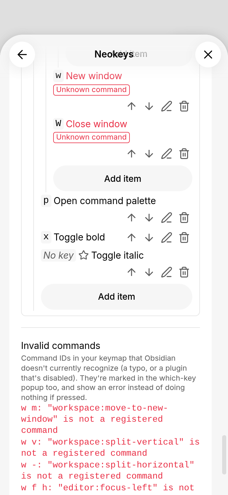

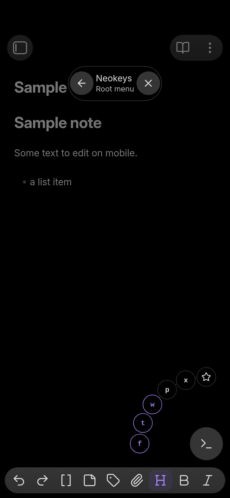

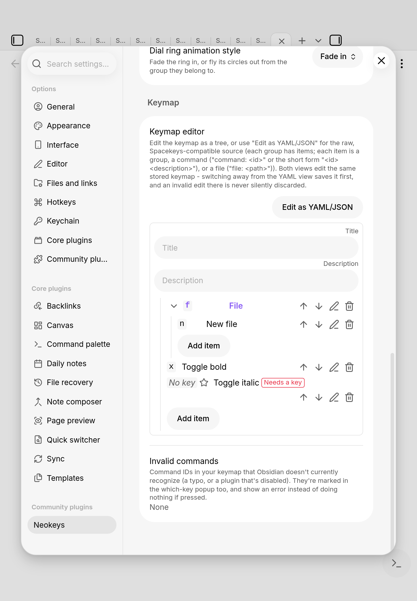

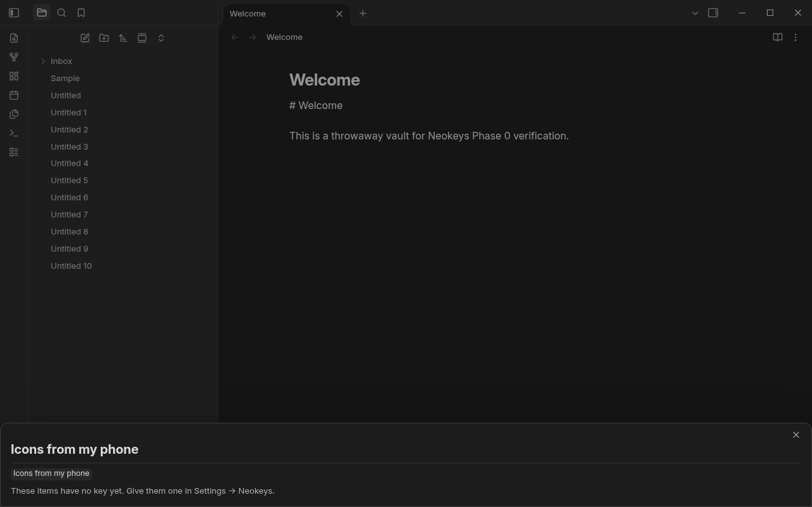

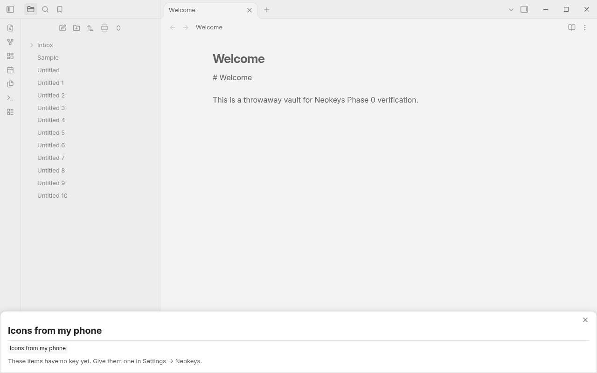

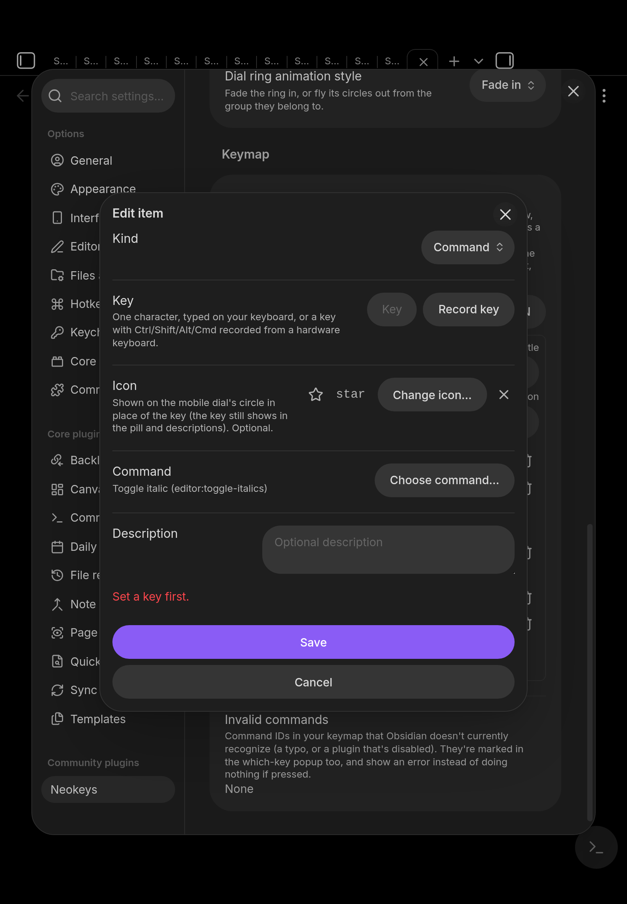

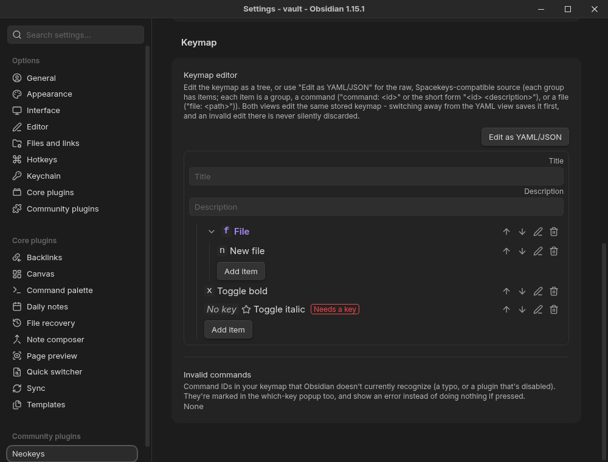

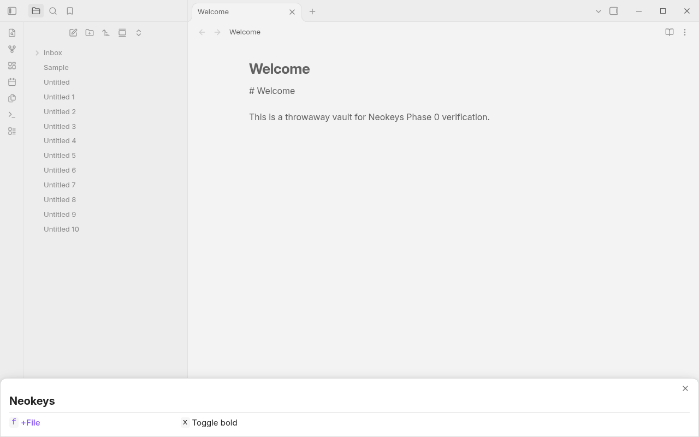

```yaml
title: Neokeys
description: Root menu
items:
  f:
    title: File
    description: Create, open, and manage files
    items:
      n: file-explorer:new-file New file
      s: editor:save-file Save file
      d: app:delete-file Delete current file
  t:
    title: Text
    description: Formatting for the current selection or line
    items:
      h:
        title: Heading
        description: Set or remove the current line's heading level
        items:
          '1': editor:set-heading-1 Heading 1
          '+': neokeys:increase-heading-level Increase heading level
          '-': neokeys:decrease-heading-level Decrease heading level
```

### The default keymap

A fresh install ships with four root groups: **File** (`f`), **Text** (`t`), **Window** (`w`),
and **Command palette** (`p`). Text groups formatting under five subgroups - **Formatting** (`f`:
bold, italic, strikethrough, code, highlight, blockquote, clear formatting), **Heading** (`h`:
set heading 1-6, remove heading, and increase/decrease heading level), **Link**
(`l`: Markdown link, wikilink, embed), **List** (`-`: bullet/numbered list, checklist, indent), and
**Add** (`a`: table, code block, math, footnote, horizontal rule, callout, tag). Window groups
tab/split/window management, loosely following the terminal multiplexer herdr's tab/pane/workspace
mnemonics (`c` for new, not `n`, so `n`/`p` stay free for next/previous); splitting is bound
directly on `v` (split right) and `-` (split down), not through a submenu.

#### Increase/decrease heading level

Obsidian has no built-in command to shift a heading's level up or down - only jump to an absolute
level (`editor:set-heading-1`..`-6`) or remove it (`editor:set-heading-0`). Neokeys adds its own
`neokeys:increase-heading-level` and `neokeys:decrease-heading-level` commands (bound to `h +` /
`h -` in the Heading submenu) that read the current line's heading level and step it by one.
"Increase" cycles plain text -> H1 -> H2 -> ... -> H6 -> plain text; "decrease" is the exact
reverse, plain text -> H6 -> H5 -> ... -> H1 -> plain text. Both ends wrap rather than stopping, so
either command can be pressed repeatedly to cycle through every level. Both commands apply to
every line touched by the current selection, or the cursor's line when nothing is selected; a
multi-line selection that ends at the very start of a line leaves that last line alone.

A key string is an optional run of modifier letters (`c`/`s`/`a`/`m` for ctrl/shift/alt/meta)
followed by a `-` and a base key, e.g. `c-enter` for Ctrl+Enter, or just a single character for
an unmodified key, e.g. `f`. Printable characters are case-sensitive: `F` is Shift+F, and `s-f`
or `cs-f` are equivalent to `F` and `c-F`. Any other shifted character must be written as the
character itself, e.g. `?` rather than `s-/` or `!` rather than `s-1`; those forms are rejected.
A handful of named keys are recognized as aliases: `space`, `up`/`down`/`left`/`right`, `enter`,
`esc`, `tab`, `backspace`, `delete`, `home`, `end`, `pageup`, `pagedown`, `insert`, and
`f1`–`f12`.

Tree edits save immediately. In the YAML/JSON view, click **Save keymap** to apply changes; an
invalid keymap is rejected with an error message that points at the exact field (e.g.
`items.f.items.d`) that needs fixing, and the previously saved keymap keeps working until you fix
it.

Any edit made in the tree editor rewrites the stored keymap in a normalized YAML form: comments are
dropped and the short command form (`"<command-id> <description>"`) is expanded into explicit
`command`/`description` fields. Editing only through the YAML/JSON view never rewrites anything, so
your comments and formatting are kept exactly as you wrote them there. Deleting a group that still
has items asks for confirmation first, naming the group and how many entries it contains; deleting
anything else happens in one click.

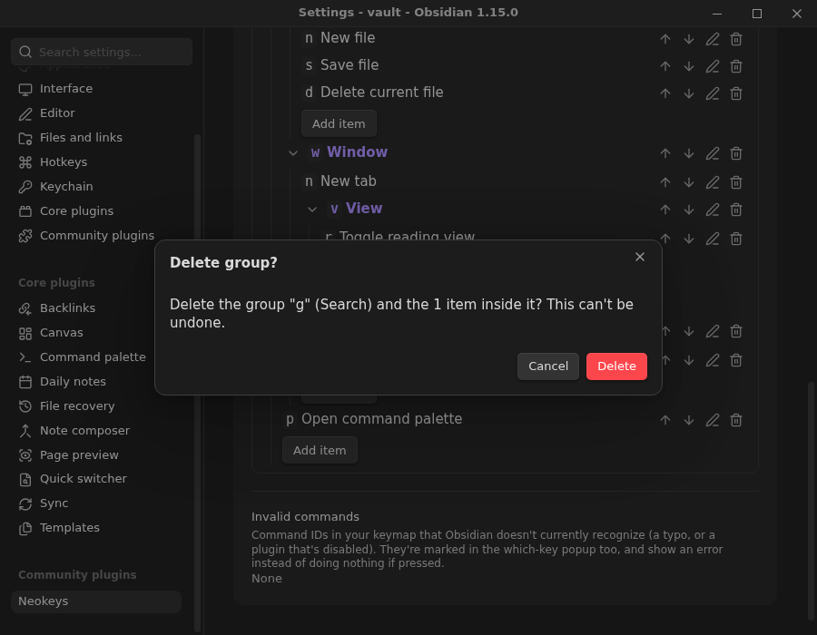

A keymap can still *parse* successfully but reference a command ID Obsidian doesn't currently
recognize (a typo, or a plugin that's disabled) - this doesn't block saving, since the command
might belong to a plugin you just haven't enabled yet. Settings → Neokeys lists any such entries
under **Invalid commands**, by key path and command ID, and the which-key popup marks the same
entries in red with an "Unknown command" badge; pressing one shows a notice instead of silently
doing nothing.

The **show delay** setting controls how long (in milliseconds) the popup waits before revealing
the key/label grid (with animations on, the whole bar waits, then slides in as its backdrop fades
in), so a sequence you already know by muscle memory never flashes it. There is no forced
abandon-timeout: a half-typed sequence waits indefinitely until it resolves, dead-ends, is
backspaced away, or you press Esc.

## Mobile

On phones and tablets, Neokeys replaces typing with a **dial**: a leader button (a `>_` prompt)
pinned to a bottom corner of the screen. Press it and the root menu's keys fan out on a ring of
small circles around it, each circle showing its key (or its icon, if the keymap gives the item one), groups rimmed in the accent colour.
Drag onto a group and its own keys open on the next ring out, so one drag walks the keymap: root,
then Text, then Heading, then the digit you want. Let go on a command to run it, on a file to open
it; let go on a group and its ring simply stays open for the next press. Passing over an item on
the way only highlights it, so nothing happens until you release. A tap on the button once the dial
is open closes the deepest ring (or the dial, at the root), the way <kbd>Backspace</kbd> does in
the keyboard popup. The note dims behind the open dial; a tap on that dimmed area closes it without
running anything.

The rings are always in the same places: the first where four circles fit, each next ring far
enough out that a circle grown by the lens never reaches a circle on the next ring, so the hand
learns where each level is. A level with more items than its ring holds at full size keeps every
circle on the ring's own radius, and while your thumb is on the ring it shrinks the circles the
farther they are from it, but never below a readable 24px: a circle that cannot be that large for
want of room is not drawn as a blank dot, it fades out. So the circle under your thumb and a few
beside it always show their keys, and the rest of the level waits out of sight until you slide
toward it. The circle under your thumb
grows, up to one and a half times the circle size by default, its neighbours a little less: a
**lens** that follows the thumb along every ring, so a crowded ring reads as you pass over it and
the grown circle doubles as the highlight. While your thumb is on a ring, no two circles ever
overlap. On a ring that is not
crowded the lens takes its room from the other gaps on the ring, which close up as far as keeps
their circles apart (the root ring, full with four circles, gets most of the lens mid-ring, all of
it at its ends); on a crowded one the circles under the thumb stay big and the sizes fall away on
either side, and the arc may run a few degrees past the ends of its quarter turn. A level that
cannot show all of its circles at the readable size (more than about five items on the first ring,
nine on the second, fourteen on the third and nineteen on the fourth, at the default circle size
on a 390px-wide phone) loses the circles far from your thumb instead: they fade out and are gone,
neither drawn nor tappable, while the ones near it stay whole and the circle under your thumb
keeps its key. They come back as you slide toward them and the ones at the other end drop out, so
every item can still be brought under your thumb by sliding along the ring. Near an end of a ring
there is room beside the circle under your thumb on one side only, so fewer circles show there. A
ring your thumb has not been on yet, at rest, shows all of its circles, shrunk to fit as far as
10px, and they grow to the readable size as your thumb arrives (a ring that big at rest, 17 or
more items on the first ring, lets the circles touch). A ring you have left keeps its lens where
your thumb left it, so the path you took stays large and the far circles of a level that big stay
gone.

Dragging from a group to a sibling group on the same ring (File to Text, say) swaps the child ring
in place: the old ring fades or flies away while the new one comes in, in the style you chose below,
rather than the new ring popping in over the old.

A pill just below Obsidian's header names what you are on: the path of open groups, the item under
your thumb at its end, and on a second line what that item does: a group's description (or its
keys and labels, when it has none), a command's name in Obsidian when the keymap labels it
something else, a file's path; the text is centred in the pill whether it has one line or two. On
a narrow phone the start of the path gives way to an ellipsis, so the item under your thumb is the
last thing ever shortened. Back and Close buttons sit at either end. An item with an icon (see
below) shows its key in the pill as a small chip, since its circle shows the icon instead.

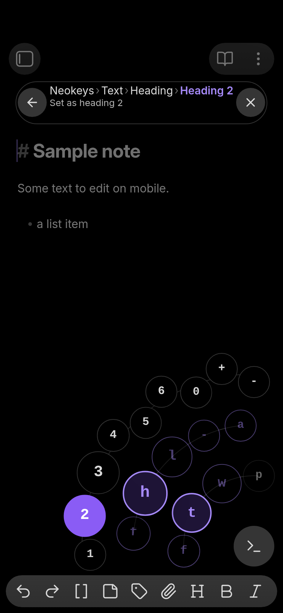

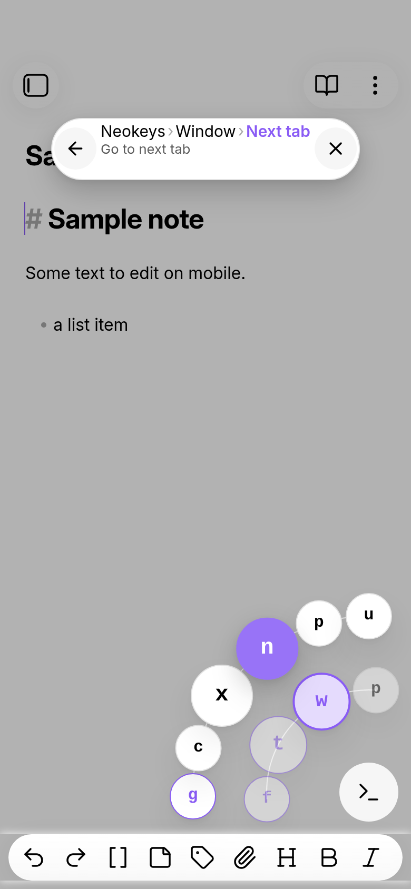

Taps work too. A tap on a circle of 32px or more does what a release on it does: a command runs,
a file opens, a group opens its ring. A tap on a smaller bead brings it into the lens first, so a
small target is never run by accident; the next tap runs it (a bead that is a group opens its ring
on the first tap, since that is harmless, and grows at the same time).

Nothing moves while your finger is down except the lens. The pill picks its place once per
opening: below the header when the keymap's deepest path fits under it, raised over the header
when that wins back room (a phone with its keyboard up). On a screen too short for even the first
ring under the raised pill the whole dial shrinks instead, smaller circles on a smaller ring (down
to 28px), so that it fits between the pill and the keyboard; no circle ever hides behind the pill.
When a group's ring has no room outside the current ones,
the group stays highlighted, the pill says to let go, and the release redraws the dial from the
deepest levels that fit; Back brings the outer rings back. On a 390px phone the default keymap's
deepest path (root, Text, Heading) opens whole on three rings with the keyboard up or down.

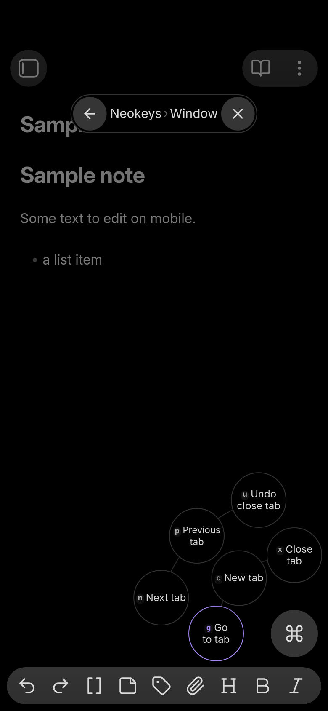

The dial keeps clear of the on-screen keyboard, Obsidian's editing toolbar and its navigation bar,
and touching it never takes focus away from the note, so a selection stays selected and the
keyboard stays up. If the keyboard or a bar comes or goes while the dial is open, the rings move
with it in place. Items that reference a command Obsidian does not have on this device (several
of the default keymap's window commands are desktop-only, for instance) are left out of the dial,
along with any group that would be left empty, since there is nothing a phone could do with them;
the keyboard popup still lists them in red, which is also where a mistyped command id shows up.

With a hardware keyboard (an iPad with a keyboard, say) the open dial answers keys exactly like
the popup: a key bound in the deepest open group picks that item, <kbd>Backspace</kbd> goes back,
<kbd>Esc</kbd> closes, and nothing you type while it is open reaches the note. Each item is also
exposed to screen readers as a button named after its label and key.

Settings → Neokeys has a **Mobile dial** group, shown only on phones and tablets (desktop has no
dial, so the group is hidden there; the values stay saved and still apply on a phone or tablet the
settings sync to), with a **Show the dial on mobile** toggle (on by default), a **Dial corner**
choice, bottom right or bottom left, a **Dial item size** slider (the circles' diameter, 40 to 56px,
44 by default), a **Dial ring radius** choice between fixed rings (the default, described above) and
fit, where each ring grows until its level fits at full size as far as the screen allows, a **Dial
lens** slider for how much the circle under your thumb grows (1 to 1.5 times the item size; at 1
only shrunk beads grow, back to full size), a **Dial ring animation** toggle with a **Dial ring
animation style** choice, fade in or fly out from the group the ring belongs to (the **Animations**
toggle above governs this and the easing of the circles as they move, and neither animates when your
OS asks for reduced motion), and a **Dial description** choice for where the item under your thumb
is described beyond the pill's own line: nowhere else (the default), on a card between the pill and
the rings, or in a bubble beside your thumb. The bubble always sits next to the thumb, never under
it, and keeps off the hand as far as the screen allows, at either end of a ring included, in either
corner, at any ring depth and with the keyboard up. It keeps off the anchor and the circles either
side of the one under your thumb, which you slide to next, but it may cover the keys of the circles
beyond them (the far circles of a crowded ring, or a group's children) rather than move away from
your finger. Where it could not sit beside the thumb in full (a small phone with its keyboard up, or
a ring crowded close around the thumb) it shrinks to the key and label, since the pill shows the
description too.

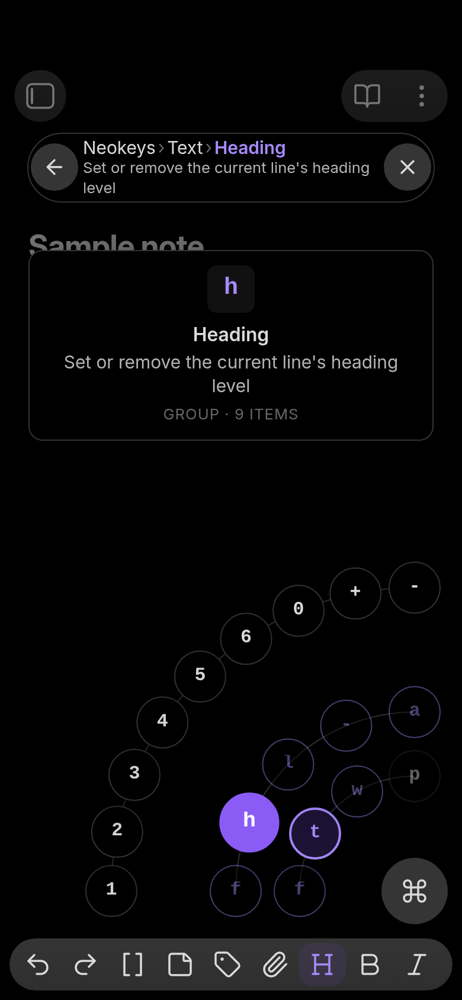

#### Adding and editing items on a phone or tablet

The **Add item** / **Edit** dialog adapts to the device (Obsidian's phone and tablet detection, not
the screen width). **Record key** waits for a physical key press, which a touch screen cannot give
it, so on a phone or tablet the **Key** row is a small text box: tap it, the on-screen keyboard
opens, and type one character, a letter in either case (`F` is Shift+F), a digit or a symbol. The
key is read from what you typed, not from key events, which soft keyboards do not send reliably.
**Record key** stays next to the box on a phone and a tablet alike, for a hardware keyboard, which
can record a key with Ctrl, Alt or Cmd (whether one is attached cannot be told reliably). A key
already used by a sibling in the same group is still refused, everywhere.

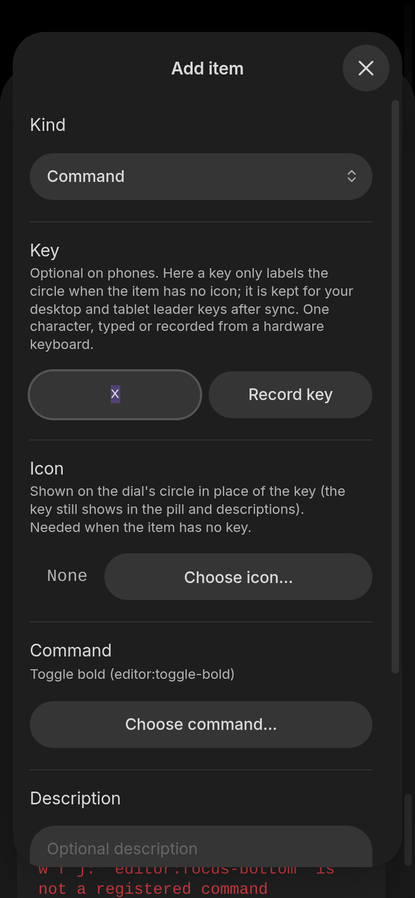

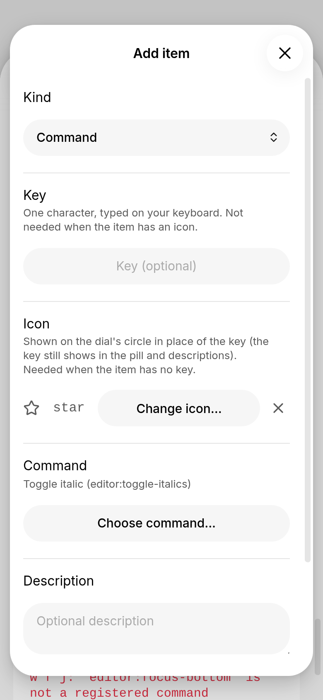

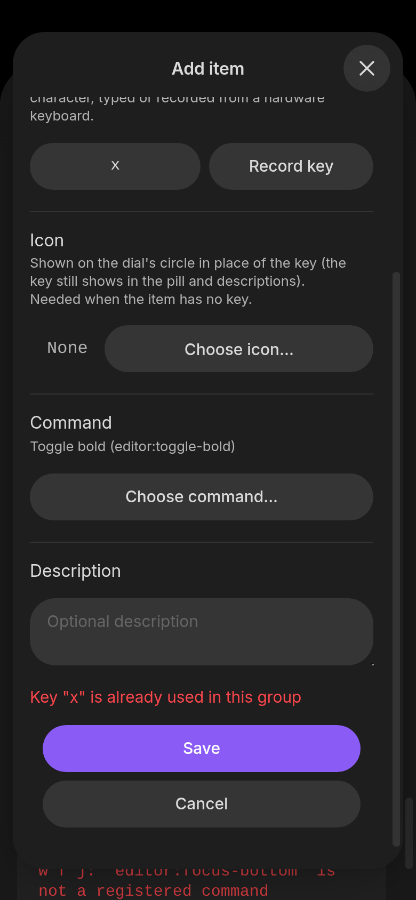

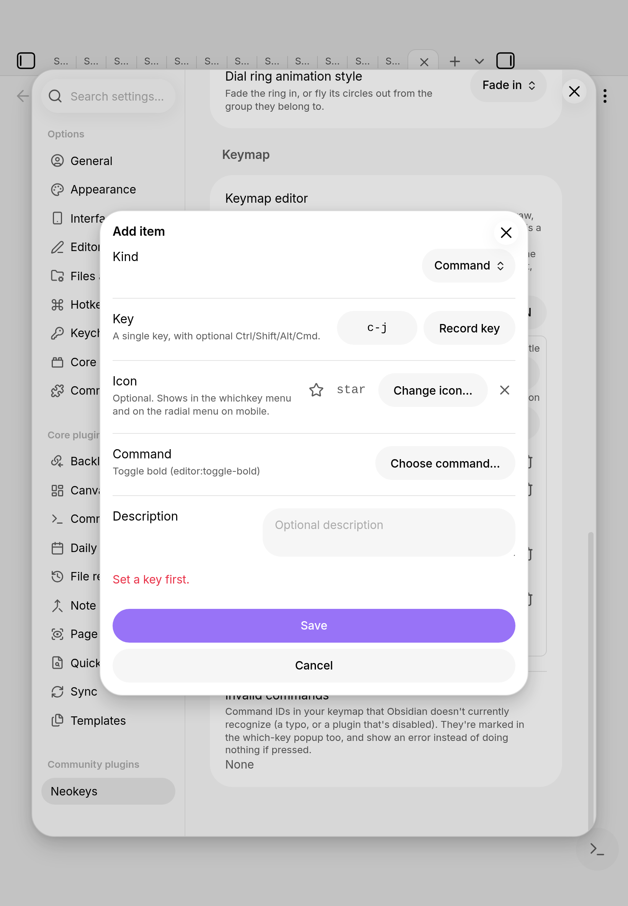

What an item needs before it saves depends on the device:

| Device | Key | Icon |
| --- | --- | --- |
| Phone | a key **or** an icon | either one is enough |
| Tablet | required | optional |
| Desktop | required | optional |

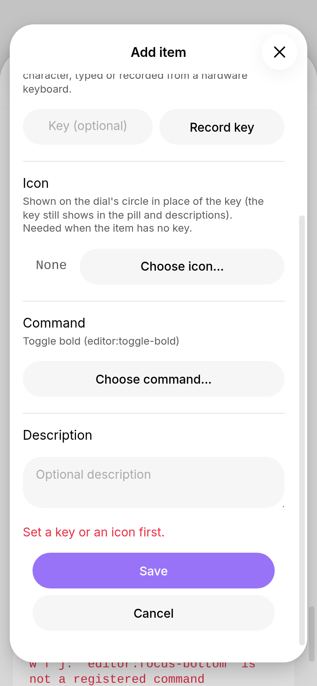

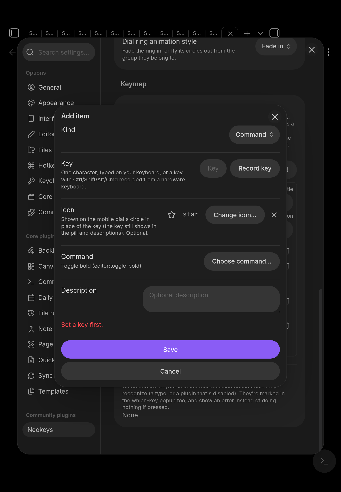

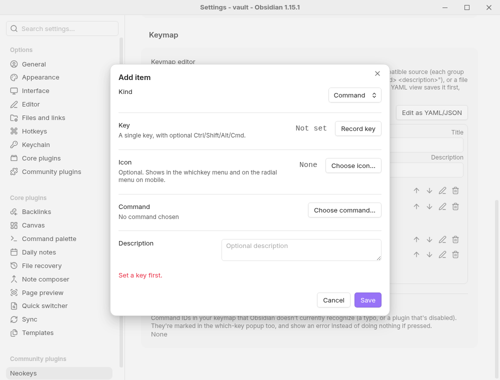

On mobile the **Leader** group of Settings → Neokeys (the leader hotkey, the combo leader and the
hotkey-conflict check) is hidden, since the dial is the way in; the settings reappear on desktop
unchanged. A hardware-keyboard combo leader you set up earlier keeps working. The other way round,
the **Mobile dial** group is hidden on desktop.

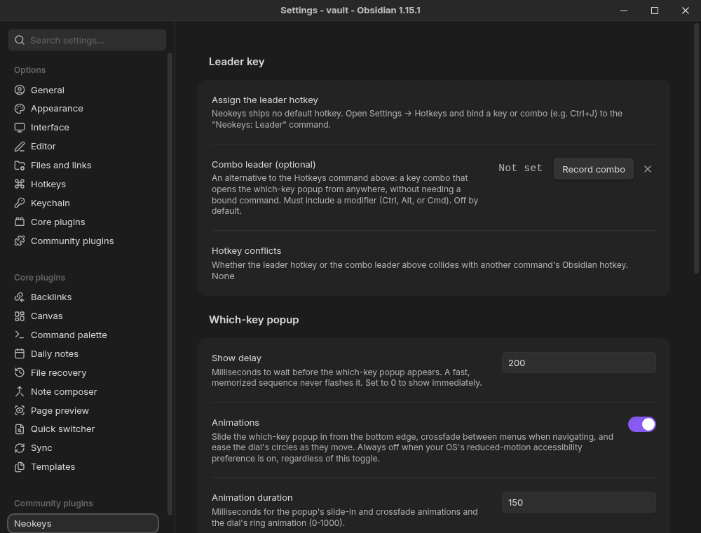

A theme or CSS snippet can restyle the items through `--neokeys-dial-item-radius`,
`--neokeys-dial-item-background`, `--neokeys-dial-item-border`, `--neokeys-dial-item-color` and
`--neokeys-dial-arc-color`. With the dial off, the Leader command on mobile opens the
keyboard-driven popup instead, which is only useful with a hardware keyboard. Desktop is
unaffected either way.

## Compatibility

Desktop and mobile. On desktop the leader opens the keyboard-driven which-key popup; on mobile the
pinned dial above is the way in, and the Leader command (from the command palette, or a combo
leader or hotkey on a hardware keyboard) opens that same dial, which the keyboard can then drive.

## Development

- `npm install`
- `npm run dev` - esbuild in watch mode
- `npm run build` - typecheck + production build
- `npm test` - Jest unit tests (key parsing, keymap parsing/validation and serialization, tree
  edit operations, tree resolution/sorting, delay logic, combo-leader validation, command-ID
  validation, breadcrumb building, hotkey-conflict detection, animation settings, heading-level
  increase/decrease, entry icons, items with no key and the per-device key/icon rules of the
  add/edit dialog, the typed-key reader, the mobile dial's ring layout, description-bubble
  placement and sibling-ring swap diff, and its drag/arm/release state machine)
- `npm run lint` - ESLint with `eslint-plugin-obsidianmd`'s recommended config, plus
  `@eslint/css`'s `no-important` on `styles.css`, mirroring the community directory's source and
  CSS scans (see `eslint.config.mjs` for why the plugin version is pinned)
- `npm run validate` - mirrors the parts of Obsidian's community-plugin submission checks that
  don't require a live GitHub release (manifest/versions shape, `id`/`version` format)

### Branching and releases

Feature and fix PRs target `dev`, not `main` (`.no-mistakes.yaml` sets this as the default PR
base branch); CI runs on pushes and PRs to both. `main` stays the GitHub default branch, since
Obsidian reads the default branch's manifest for the community-plugin listing.

To cut a release: bump the version with `npm version <patch|minor|major> --no-git-tag-version`
(updates `package.json`, `manifest.json`, and `versions.json` without creating a git tag),
then open a `dev` -> `main` PR whose description is the release notes. Merging that PR into
`main` publishes the release with no manual tagging: `.github/workflows/release.yml` reads
`manifest.json`'s version on every push to `main` and, only when no release for that exact
version exists yet, runs lint/typecheck/test/build/validate, then creates the annotated tag,
then publishes the GitHub release with the PR body as notes, followed by the generated commit
list. Merging a PR without a version bump (or re-merging the same version) is a no-op release
run.

## Support

If Neokeys is useful to you, you can support its development on
[Ko-fi](https://ko-fi.com/friesentius).

## License

[MIT](LICENSE)
